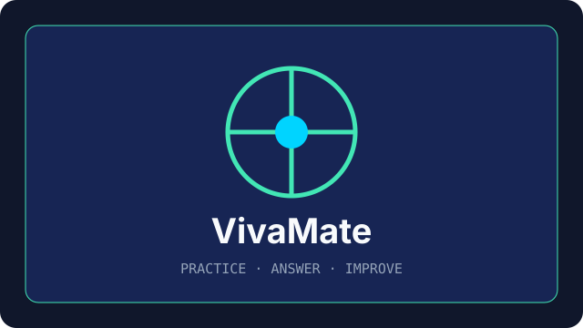
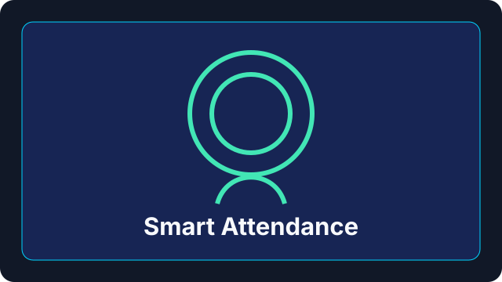

  

[01 About](#01--about-me) · [02 Experience](#02--professional-experience) · [03 Projects](#03--featured-projects) · [04 Technology](#04--technology-ecosystem) · [05 Analytics](#05--github-analytics) · [06 Contributions](#06--contributions) · [07 Achievements](#07--achievements--milestones) · [08 Journey](#08--developer-journey) · [09 Beyond](#09--beyond-the-horizon) · [10 Connect](#10--connect)

## 01 — About Me

<table>
<tr>
<td width="68%">

I'm a Computer Science Engineering student at **Coimbatore Institute of Technology**, focused on building intelligent software systems and exploring emerging technologies.

My interests span **artificial intelligence, full-stack development, software architecture, and aerospace technology**. I enjoy turning practical ideas into reliable applications, with an engineering approach grounded in clarity, curiosity and purposeful design.

Alongside my technical pursuits, I serve as **Chief Operating Officer at Kepler Nav**, contributing to the organization's broader mission in autonomous navigation technology.

</td>
<td width="32%" align="center">

**SRI SHANKAR N**  
AI Developer · Software Engineer  
Chief Operating Officer · Kepler Nav  
Coimbatore, India

</td>
</tr>
</table>

## 02 — Professional Experience

<table>
<tr>
<td width="18%" align="center">

</td>
<td width="82%">

### Kepler Nav
**Chief Operating Officer**

Contributing to the development and broader execution of an ambitious deep-space navigation technology initiative, exploring autonomous positioning, navigation and timing beyond conventional GPS infrastructure.

**Organization technology areas:** X-ray Pulsar Navigation (XNAV) · UNIF-PNT autonomous navigation architecture · Kalam hardware acceleration · Lie Group manifold-based state estimation · Cislunar and interplanetary navigation

</td>
</tr>
</table>

## 03 — Featured Projects

<table>
<tr>
<td width="50%" align="center">

<b>CodeBro</b> 
Coding learning platform powered by AI-oriented workflows. 
<code>JavaScript</code> <code>TypeScript</code> <code>CSS</code> <code>Supabase</code> 
<a href="https://github.com/SriShankar2006/CodeBro">Repository</a> · <a href="https://code-bro-mauve.vercel.app">Live demo</a>
</td>
<td width="50%" align="center">

<b>VivaMate</b> 
Desktop application for course-wise viva and interview preparation. 
<code>Python</code> 
<a href="https://github.com/SriShankar2006/VivaMate">Repository</a>
</td>
</tr>
<tr>
<td align="center">

<b>VoicePilot</b> 
Voice-controlled Chrome extension for hands-free browser navigation. 
<code>JavaScript</code> <code>HTML</code> 
<a href="https://github.com/SriShankar2006/VoicePilot">Repository</a>
</td>
<td align="center">

<b>CloudNotesApplication</b> 
Cloud-based notes application using Supabase and modern web technologies. 
<code>JavaScript</code> <code>HTML</code> <code>Supabase</code> 
<a href="https://github.com/SriShankar2006/CloudNotesApplication">Repository</a>
</td>
</tr>
<tr>
<td align="center">

<b>Smart Attendance System</b> 
Face-recognition attendance system with recognition and reporting workflows. 
<code>Python</code> 
<a href="https://github.com/SriShankar2006/Smart-Attendance-System-using-Face-Recognition">Repository</a>
</td>
<td align="center">

<b>Kepler Nav</b> 
Professional involvement in autonomous deep-space navigation. 
<code>XNAV</code> <code>PNT</code> <code>Cislunar</code> 
<a href="https://keplernav.com">Organization website</a>
</td>
</tr>
</table>

## 04 — Technology Ecosystem

**Programming Languages**

**Frontend**

**Backend & Data**

**Developer Tools**

## 05 — GitHub Analytics

  
  

  

  

## 06 — Contributions

  

<b>Animated contribution calendar fallback</b>

 

  

  <picture>
    <source media="(prefers-color-scheme: dark)" srcset="./profile-3d-contrib/profile-night.svg">
    
  </picture>
  

## 07 — Achievements & Milestones

  

## 08 — Developer Journey

- **Programming Foundations** — Began developing software and problem-solving skills.
- **Computer Science Education** — Pursuing B.E. Computer Science and Engineering at Coimbatore Institute of Technology.
- **Full-Stack Development** — Building web applications, browser extensions and cloud-backed tools.
- **AI Exploration** — Exploring intelligent application workflows and machine-learning systems.
- **Project Engineering** — Developing and publishing personal applications across desktop, web and browser platforms.
- **Leadership & Organization** — Serving as Chief Operating Officer at Kepler Nav.
- **Current Direction** — Combining software engineering, AI and next-generation autonomous navigation.

## 09 — Beyond the Horizon

**Exploring the intersection of intelligent software, autonomous systems and next-generation aerospace technology.**

The work below includes areas presented publicly by Kepler Nav and is not represented as personal research or invention.

## 10 — Connect

**Building with curiosity. Engineering with purpose. Innovating beyond boundaries.**

