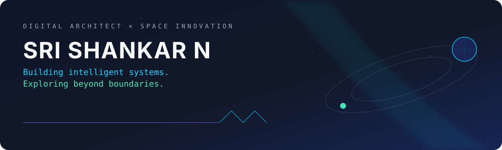

  

[ABOUT](#about) &nbsp;·&nbsp; [EXPERIENCE](#experience) &nbsp;·&nbsp; [PROJECTS](#selected-work) &nbsp;·&nbsp; [TOOLKIT](#toolkit) &nbsp;·&nbsp; [GITHUB ACTIVITY](#github-activity) &nbsp;·&nbsp; [CONNECT](#connect)

## About

<table>
<tr>
<td width="70%">

I'm a Computer Science and Engineering student at **Coimbatore Institute of Technology**, interested in building useful software and exploring intelligent systems.

I work across web and application development, with a growing focus on **AI, software engineering, and autonomous navigation**. I value thoughtful problem-solving, clear design, and turning ideas into practical tools.

</td>
<td width="30%" align="center">

**SRI SHANKAR N**  
AI Developer · Software Engineer  
Coimbatore, India

</td>
</tr>
</table>

## Experience

<table>
<tr>
<td width="16%" align="center">

</td>
<td width="84%">

### Kepler Nav · Chief Operating Officer

Contributing to the development and broader execution of an ambitious deep-space navigation technology initiative, exploring autonomous positioning, navigation and timing beyond conventional GPS infrastructure.

PUBLIC TECHNOLOGY AREAS 
XNAV · UNIF-PNT · Kalam hardware acceleration · Lie Group state estimation · Cislunar and interplanetary navigation

</td>
</tr>
</table>

## Selected Work

<table>
<tr>
<td width="50%" align="center" valign="top">

<h3>CodeBro</h3>
Competitive coding and e-learning platform with code execution workflows.
  JAVASCRIPT · TYPESCRIPT · FIREBASE · SUPABASE · JUDGE0
  <a href="https://github.com/SriShankar2006/CodeBro">SOURCE</a> &nbsp;·&nbsp; <a href="https://code-bro-mauve.vercel.app">LIVE PROJECT</a>
</td>
<td width="50%" align="center" valign="top">

<h3>VoicePilot</h3>
Chrome extension for voice and keyboard-driven browser navigation.
  JAVASCRIPT · HTML · CHROME EXTENSION
  <a href="https://github.com/SriShankar2006/VoicePilot">VIEW REPOSITORY</a>
</td>
</tr>
<tr>
<td align="center" valign="top">

<h3>VivaMate</h3>
Desktop app for course-wise viva and interview practice, voice answers, and self-evaluation.
  PYTHON · DESKTOP APPLICATION
  <a href="https://github.com/SriShankar2006/VivaMate">VIEW REPOSITORY</a>
</td>
<td align="center" valign="top">

<h3>CloudNotesApplication</h3>
Cloud-backed notes with authentication, file uploads, and personal data access.
  JAVASCRIPT · HTML · CSS · SUPABASE
  <a href="https://github.com/SriShankar2006/CloudNotesApplication">VIEW REPOSITORY</a>
</td>
</tr>
<tr>
<td align="center" valign="top">

<h3>Smart Attendance</h3>
Face-recognition attendance workflow with model training and reporting.
  PYTHON · KNN · SVM
  <a href="https://github.com/SriShankar2006/Smart-Attendance-System-using-Face-Recognition">VIEW REPOSITORY</a>
</td>
<td align="center" valign="middle">

BUILDING SOFTWARE THAT SOLVES REAL PROBLEMS

### More projects

Explore my repositories for experiments and other work.

</td>
</tr>
</table>

## Toolkit

<b>Languages & Web</b>

  

<b>Platforms & Tools</b>

  

Shown technologies are drawn from public project repositories; icons indicate tools used, not proficiency ratings.

## GitHub Activity

## Beyond the Horizon

My work at Kepler Nav connects my interest in software with the challenge of autonomous navigation beyond Earth. I’m especially interested in how intelligent systems can support reliable positioning, navigation, and timing in environments without conventional infrastructure.

## Connect

**Building with curiosity. Engineering with purpose. Innovating beyond boundaries.**

